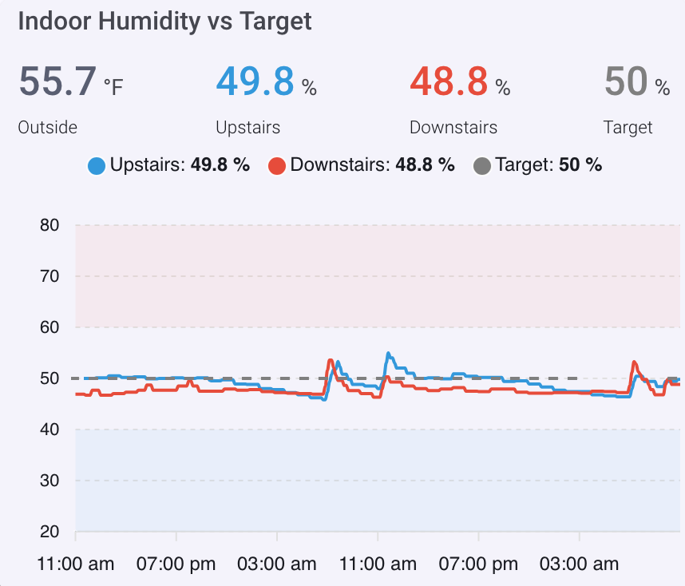

# Convert an Aprilaire 400 to a 600 (plus optional Home Assistant control)

Convert an Aprilaire 400 waterless bypass humidifier to Aprilaire 600 flow-through operation using the AprilAire 4839 maintenance kit, a hot water feed, and a drain line. You can keep your existing humidistat, or optionally replace it with Home Assistant smart control that dynamically adjusts target humidity based on outdoor temperature.

## Table of Contents
- [Overview](#overview)
- [The Problem](#the-problem)
- [The Solution](#the-solution)
- [Hardware Requirements](#hardware-requirements)
- [Installation](#installation)
  - [Part 1: Hardware Conversion (400 to 600)](#part-1-hardware-conversion-400-to-600)
  - [Part 2: Optional Home Assistant Smart Control](#part-2-optional-home-assistant-smart-control)
- [Home Assistant Configuration](#home-assistant-configuration)
- [How It Works](#how-it-works)
- [ApexCharts Humidity Tracking](#apexcharts-humidity-tracking)
- [Shelly failsafe settings](#shelly-failsafe-settings)
- [Safety](#safety)
- [Results](#results)
- [Lessons Learned](#lessons-learned)

## Overview

This guide has two parts:

1. **Hardware conversion (400 → 600)**: Upgrade an Aprilaire 400 bypass humidifier to Aprilaire 600 flow-through operation with the 4839 maintenance kit, a drain line, and a hot water feed. If you just want better humidification performance, you can stop after Part 1 and keep your existing humidistat.
2. **Optional Home Assistant smart control**: Replace the mechanical humidistat with a Shelly dry-contact relay, indoor Zigbee humidity sensors, and outdoor weather data so Home Assistant dynamically adjusts target humidity based on outdoor temperature using deadband logic to prevent short-cycling.

## The Problem

On the forced hot-air furnace, the Aprilaire 400 humidifier was unable to maintain proper indoor humidity levels during winter months. This was due to two main factors:

1. **Waterless (wicking) design limitations**: Both the Aprilaire 400 and 600 are bypass humidifiers, but the 400 is a waterless, float-controlled wicking design with no drain. That limits evaporation capacity compared to the 600's flow-through design.
2. **Hard water buildup**: Because water sits and evaporates out of the panel instead of flushing to a drain, mineral deposits build up quickly on the #45 water panel and further limit performance over time.

## The Solution

The solution is split into a hardware upgrade and an optional smart automation layer:

### Part 1: Hardware Upgrade (400 → 600)
- Convert Aprilaire 400 waterless operation to Aprilaire 600 flow-through operation using the **[AprilAire 4839 Maintenance Kit](docs/images/aprilaire-4839-maintenance-kit.png)**
- Install a drain line for continuous water flow (1" OD PVC)
- Move the water supply to the hot water line for better evaporation
- If draining to a condensate pump, relocate the pump lower if needed to achieve proper drainage slope
- Note: Future replacement water panels change from **#45** (Aprilaire 400) to **#35** (Aprilaire 600)

### Part 2: Optional Home Assistant Smart Control
- Replace the mechanical humidistat with a Shelly dry-contact relay
- Install multiple sensors for accurate whole-house humidity and outdoor temperature readings
- Calculate optimal indoor humidity based on outdoor temperature
- Automate humidifier operation with deadband control logic

## Hardware Requirements

### Humidifier Conversion Components (Required)
- Aprilaire 400 (existing humidifier)
- **[AprilAire 4839 Maintenance Kit](docs/images/aprilaire-4839-maintenance-kit.png)** (converts 400 to 600 flow-through operation; future replacement water panels change from #45 to #35)
- 1" OD PVC pipe for drain line and needed connections (90 and/or 45)
- Condensate pump relocation (if needed for slope and if no nearby floor drain available)
- Saddle valve or T-valve for hot water connection

### Smart Home Components (Optional — Home Assistant Control)
- **Shelly 1 Gen4** Wi-Fi/Zigbee/Matter Smart Relay Switch with dry contacts
- **12V 2A Power Adapter** (to power the Shelly relay)
- **(2) SONOFF SNZB-02P** Zigbee Temperature/Humidity Sensors
- Home Assistant server with Zigbee coordinator

### Weather Data (Optional — Home Assistant Control)
- Access to **Ambient Weather Network** or similar local weather station data
- Multiple stations recommended for averaging (this project uses 5 local stations)

## Installation

### Part 1: Hardware Conversion (400 to 600)

1. **Install [AprilAire 4839 Maintenance Kit](docs/images/aprilaire-4839-maintenance-kit.png)**
   - Follow AprilAire instructions to convert your 400 to 600 configuration
      - This is straight forward as it is simply replacing the internal frame of the water panel, and installing the drain which is a small insert.
   - This enables continuous flow-through operation
   - **Water panel note**: Going forward, your converted unit uses **AprilAire #35** replacement water panels instead of #45.

2. **Install Drain Line**
   - Run 1" OD PVC from humidifier to drain
   - Ensure proper slope for gravity drainage - 1/4" per foot
   - If nearby floor drain isn't available, you may need to relocate the condensate pump lower

3. **Move Water Feed to Hot Line**
   - Install a new saddle valve (or better a T-valve) on the hot water line for the humidifier feed - More effective evaporation
   - Cap the old cold water saddle valve

4. **Relocate Condensate Pump** (if needed)
   - Lower the condensate pump position to achieve proper drainage slope from humidifier
   - This step may not be necessary if you have a conveniently located floor drain

> **Keeping your original humidistat?** You can stop here. Check for leaks and test drain flow (see [Safety](#safety)), then run the converted 600 with your existing humidistat. Continue to Part 2 below if you want to add Home Assistant automation.

### Part 2: Optional Home Assistant Smart Control

#### Wiring & Sensors

1. **Remove Mechanical Humidistat**
   - Disconnect the existing Aprilaire humidistat
   - This will be replaced by the Shelly relay

2. **Install Shelly 1 Gen4 Relay**
   - Wire the Shelly relay to control the humidifier water solenoid valve
      - The Shelly's dry contact switches the heat-call signal (W1/B on the EWC Ultra-Zone NCM-300 zone panel) to the water solenoid. Common (C) connects directly to the solenoid return.
      - The solenoid only opens when the furnace is calling for heat AND Home Assistant calls for humidity.
      - No zone panel? Use the furnace board's W or HUM terminal. Never use R, which is hot all the time and would run water to the drain even when the furnace is idle.
   - Connect to 12V power supply
   - Configure for dry contact operation
   - Integrate with Home Assistant

3. **Install Humidity Sensors**
   - Mount one SONOFF SNZB-02P sensor centrally on each floor (upstairs and downstairs)
   - Pair sensors with your Zigbee coordinator

#### Home Assistant Integration

1. **Add Shelly Relay to Home Assistant**
   - The relay should appear as `switch.furnace_humidity_control` (or customize as needed)

2. **Add SONOFF Sensors to Home Assistant**
   - Sensors should appear with entities like:
     - `sensor.downstairs_temp_humidity_humidity`
     - `sensor.upstairs_temp_humidity_humidity`

3. **Configure Weather Station Integration**
   - Set up Ambient Weather Network integration or similar
   - Ensure you have multiple local temperature sources for averaging

## Home Assistant Configuration

### Template and statistics sensors

Add these to `configuration.yaml`, or drop `humidity_templates.yaml` into your [packages](https://www.home-assistant.io/docs/configuration/packages/) folder. Rename the `sensor.*` entity IDs to match your own devices.

The file creates 4 sensors:
- `sensor.whole_house_humidity`: average of the 2 indoor sensors
- `sensor.average_outdoor_temperature`: average of the weather stations that are reporting
- `sensor.outdoor_temperature_1h_average`: 1-hour rolling mean of the outdoor average
- `sensor.target_indoor_humidity`: target humidity calculated from the 1-hour mean

Each template sensor goes `unavailable` when its inputs are offline, instead of reporting a fake value. They also carry `device_class` and `state_class`, so Home Assistant keeps long-term statistics for them.

```yaml
template:
  - sensor:
      # Average indoor humidity from both floors
      # Uses whichever sensors are reporting; unavailable if neither is
      - name: "Whole House Humidity"
        unique_id: whole_house_humidity_avg
        unit_of_measurement: "%"
        device_class: humidity
        state_class: measurement
        availability: >
          {{ has_value('sensor.downstairs_temp_humidity_humidity')
             or has_value('sensor.upstairs_temp_humidity_humidity') }}
        state: >
          
          {{ ((vals | sum) / (vals | length)) | round(1) }}

      # Average outdoor temperature from multiple weather stations
      # Skips stations that are offline; a real 0°F reading still counts
      - name: "Average Outdoor Temperature"
        unique_id: avg_outdoor_temp
        unit_of_measurement: "°F"
        device_class: temperature
        state_class: measurement
        availability: >
          {{ [
            states('sensor.station_1_temperature'),
            states('sensor.station_2_temperature'),
            states('sensor.station_3_temperature'),
            states('sensor.station_4_temperature'),
            states('sensor.station_5_temperature')
          ] | select('is_number') | list | length > 0 }}
        state: >
          
          {{ ((temps | sum) / (temps | length)) | round(1) }}

      # Target humidity from the 1-hour outdoor average
      # Linear: 25% at 0°F, rising 1% per 2°F, capped at 45% (40°F and up)
      - name: "Target Indoor Humidity"
        unique_id: target_indoor_humidity
        unit_of_measurement: "%"
        device_class: humidity
        state_class: measurement
        availability: "{{ has_value('sensor.outdoor_temperature_1h_average') }}"
        state: >
          
          {{ [45, [25, 25 + t / 2] | max] | min | round(0) | int }}

sensor:
  # 1-hour rolling mean of outdoor temperature
  # Keeps the target from flipping back and forth on short temperature swings
  - platform: statistics
    name: "Outdoor Temperature 1h Average"
    unique_id: outdoor_temp_1h_avg
    entity_id: sensor.average_outdoor_temperature
    state_characteristic: mean
    max_age:
      hours: 1
    sampling_size: 200
    precision: 1
```

### Automation

Create this automation to maintain humidity levels:

```yaml
alias: Maintain Indoor Humidity Level
description: Humidifier - Maintain Target Indoor Humidity
triggers:
  - trigger: state
    entity_id:
      - sensor.target_indoor_humidity
      - sensor.whole_house_humidity
  - trigger: time_pattern
    minutes: /5
conditions:
  - condition: template
    value_template: "{{ current_rh is not none and target_rh is not none }}"
actions:
  - choose:
      - conditions:
          - condition: template
            value_template: "{{ current_rh <= (target_rh - deadband) }}"
        sequence:
          - action: switch.turn_on
            target:
              entity_id: "{{ humidifier_switch }}"
      - conditions:
          - condition: template
            value_template: "{{ current_rh >= (target_rh + deadband) }}"
        sequence:
          - action: switch.turn_off
            target:
              entity_id: "{{ humidifier_switch }}"
mode: single
variables:
  humidifier_switch: switch.furnace_humidity_control
  current_rh: "{{ states('sensor.whole_house_humidity') | float(none) }}"
  target_rh: "{{ states('sensor.target_indoor_humidity') | float(none) }}"
  deadband: 2
```

## How It Works

### Temperature-Based Humidity Targets

The target drops as it gets colder outside, so the windows don't fog or frost over. It follows a straight line: 25% at 0°F, rising 1% for every 2°F, and capped at 45% from 40°F up.

`target = 25 + (outdoor °F / 2)`, held between 25% and 45%

| 1-hour outdoor average | Target indoor humidity |
|------------------------|------------------------|
| 0°F (-18°C) or colder  | 25%                    |
| 10°F (-12°C)           | 30%                    |
| 20°F (-7°C)            | 35%                    |
| 30°F (-1°C)            | 40%                    |
| 40°F (4°C) or warmer   | 45%                    |

An earlier version used 5% steps (25, 30, 35, 40, 45). The straight line avoids a sudden 5% jump when the temperature crosses a step, and the 1-hour average keeps the target from flipping back and forth on short temperature swings.

If your windows still condense, lower the 25 at the start of the formula by a few points.

### Sensor Averaging

**Indoor Humidity**: Averages readings from sensors on both floors for accurate whole-house measurement. If one sensor drops offline, it uses the other. If both are offline, the sensor goes `unavailable` and the automation does nothing.

**Outdoor Temperature**: Averages readings from five local Ambient Weather Network stations, skipping any that are offline. A real 0°F reading still counts. The target then uses a 1-hour rolling mean of that average.

### Control Logic

The automation uses a **2% deadband** to prevent short-cycling:
- **Humidifier turns ON** when: Current humidity ≤ (Target - 2%)
- **Humidifier turns OFF** when: Current humidity ≥ (Target + 2%)

The automation triggers on:
- State changes to target or current humidity
- Every 5 minutes (time pattern)

## ApexCharts Humidity Tracking

For visibility, I use an ApexCharts card in Home Assistant to trend the whole-house humidity against the calculated target. This makes it easy to confirm the automation is holding steady, spot short-cycling, and validate the outdoor-temp-driven target curve over time.

The chart in `Humidity_chart.yaml` is set up to:
- Show outside temperature, plot upstairs and downstairs humidity on the same graph
- Draw the calculated target as a dashed gray line, so you can see how closely each floor tracks it
- Show daily context with clear min/max swings
- Make tuning the deadband and target thresholds obvious from the line separation



## Shelly failsafe settings

Home Assistant only tells the Shelly what to do. If Home Assistant crashes or loses Wi-Fi while the relay is on, the relay stays on. Set these 2 options in the Shelly's own web page (open its IP address in a browser, then go to the output settings):

- **Power-on default: Off.** After a power outage the relay comes back off, and Home Assistant turns it on again if needed.
- **Auto-off timer: 60 minutes.** The relay shuts itself off after 60 minutes no matter what. The automation re-checks every 5 minutes and turns it back on if humidity is still low, so in normal operation you'll lose a few minutes of humidifying at most.

The wiring already limits the damage, since water can only flow during a heat call. These settings cover the case where the furnace runs for hours and Home Assistant isn't there to shut the water off.

## Safety

- Turn off power to the furnace at its switch or breaker before touching any wiring. The control wiring is low voltage (24V AC), but the furnace itself runs on 120V.
- Shut off the water supply before tapping the line, and check every fitting for leaks after the first few heat cycles.
- Pour a bucket of water through the drain path before relying on it. A blocked drain or failed condensate pump will put water on the floor.
- Follow Aprilaire's installation instructions and your local codes. If you aren't comfortable with HVAC wiring or plumbing, hire a pro.

This is a description of my own install, offered as-is. You're responsible for your own system.

## Results

The system has been working very well since installation. Key improvements:

- **Consistent humidity levels**: Maintains target humidity throughout the winter
- **Eliminates manual adjustment**: No need to monitor or adjust humidistat settings
- **Prevents window condensation**: Dynamic targets prevent over-humidification in extreme cold
- **Increased capacity**: The 600 conversion provides significantly better humidification performance
- **Better water panel maintenance**: Continuous water flow helps prevent mineral buildup
- **Water usage**: Using approximately 3.5 gallons (13.25 L) per furnace cycle, though this varies depending on furnace efficiency and cycle duration

## Future upgrades

Potential next steps include:
- Automation to alert if humidity gets out of whack
- Automation to monitor for excessive water usage (currently using Droplet)
- Implement PWM (Pulse Width Modulation) for the solenoid. Instead of leaving the water on 100% of the time the fan is running, cycle it (e.g., 2 minutes on, 2 minutes off). This keeps the panel wet enough for evaporation but reduces water waste.

## Lessons Learned

### Hard Water Considerations
Hard water was a contributing factor to the original Aprilaire 400's poor performance. Even with the upgrade to 600 flow-through functionality, monitor the #35 water panel for mineral deposits and replace as needed per manufacturer recommendations.

### Drainage Is Critical
When installing the drain line, proper slope is essential. If you don't have a nearby floor drain:
- Budget time for relocating the condensate pump lower
- Ensure you have adequate vertical space to achieve proper drainage slope
- Consider this during initial planning to avoid rework

### Sensor Placement
Central locations on each floor provide the most representative humidity readings. Avoid placing sensors:
- Near exterior walls or windows
- In bathrooms or kitchens
- Near heating vents
- In direct sunlight

### Weather Station Averaging
Using multiple weather stations significantly improves accuracy:
- Reduces impact of individual station failures
- Minimizes microclimate effects
- Provides more stable temperature readings for target calculations

## Contributing

Feel free to open issues or submit pull requests if you have suggestions for improvements or find any bugs in the configuration.

## License

Released under the [MIT License](LICENSE). Use it, change it and share it.

---

**Questions?** Open an issue and I'll be happy to help!
